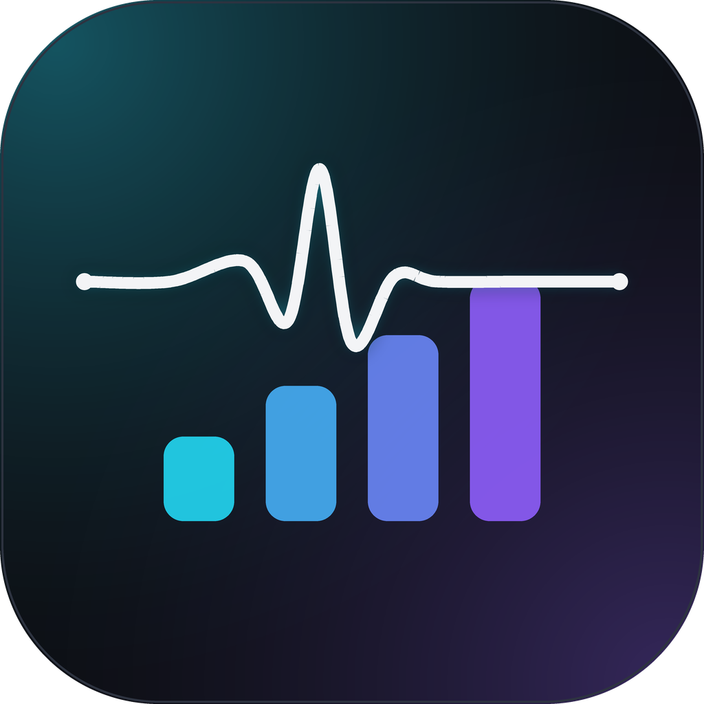
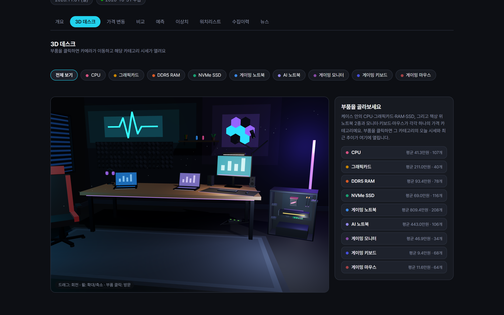
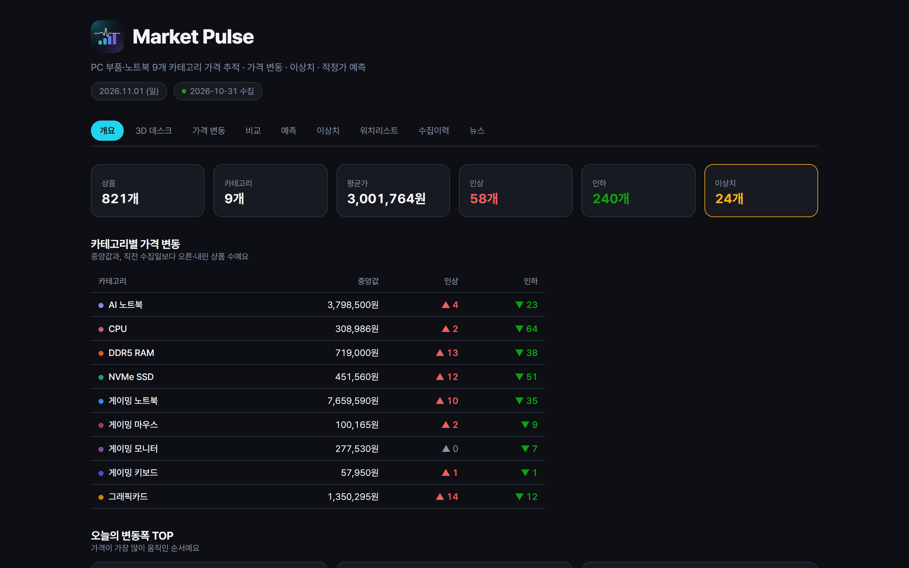
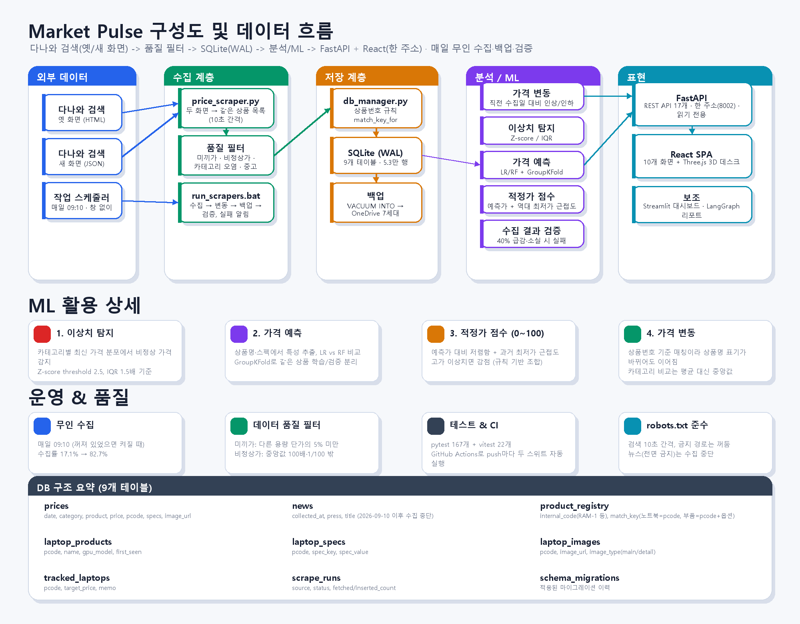

# Market Pulse

[](https://github.com/kwsahe/market-pulse/actions/workflows/tests.yml)

다나와 PC 부품·노트북 9개 카테고리 가격을 매일 자동 수집하고, 미끼가·비정상가·카테고리 오염을 걸러낸 뒤
가격 변동·이상치·스펙 기반 적정가를 보여주는 하드웨어 가격 분석 대시보드 (FastAPI + React + Three.js 3D 데스크)

**[라이브 데모](https://kwsahe.github.io/market-pulse/)** (서버 없이 돌아가는 정적 데모. 매일 수집이 끝나면 그날 데이터로 갱신되고, 편집 기능은 꺼져 있다)

[문제 해결 사례](#문제-해결-사례) · [구조](#구조) · [실행](#실행) · [운영 문서](docs/OPERATIONS.md) · [개발 문서](docs/DEVELOPMENT.md)





## 핵심 수치

2026-10-31 기준입니다.

| 항목 | 값 |
|---|---|
| 수집 범위 | 다나와 9개 카테고리, 카테고리별 검색 결과 2페이지 (2026-11-01 시험 실행 1,423행. 10-31까지는 1페이지, 하루 약 800행) |
| 누적 데이터 | 2026-03-30부터 가격 스냅샷 약 5만 3천 행 (71일치) |
| 무인 수집률 | 손으로 실행하던 시기 17.1% → 작업 스케줄러 도입 후 82.7% (빠진 날은 모두 PC가 꺼진 날) |
| 서버·화면 | FastAPI REST API 17개, React 10개 화면 + Three.js 3D 데스크 |
| 테스트 | pytest 190개 + vitest 26개, GitHub Actions에서 push마다 실행 |

## 문제 해결 사례

실데이터를 매일 모으며 실제로 부딪힌 문제들입니다. 각 사례는 숫자로 원인을 확인하고, 고친 뒤 다시 숫자로 검증했습니다.

### 1. 다나와가 검색의 25~73%를 새 화면으로 넘겼다

- **문제** — 2026-10-07부터 일부 카테고리가 하루치 통째로 0개가 됐다(10-16 NVMe SSD, 10-18 그래픽카드). 오류 없이 "성공"으로 끝나서 겉으로는 티가 나지 않았다.
- **원인** — 다나와가 검색 요청을 무작위로 개편된 새 검색 화면으로 넘긴다(서버 307 리다이렉트, 쿠키·검색어 무관). 새 화면에는 기존 파서가 찾는 마크업이 없다. 비율은 처음 20~35%에서 25~73%까지 올랐고, 옛 화면이 올 때까지 다시 요청하는 우회는 한계에 닿았다.
- **해결** — 두 화면을 모두 읽는다(`scraper/price_scraper.py`의 `_search_items`). 새 화면도 서버가 그려 보내는 HTML 안에 상품 목록 JSON이 있어, robots.txt가 금지한 내부 API 없이 읽을 수 있었다. 가격은 배송비를 뺀 최저가, 옵션은 묶음 목록, 오픈마켓 중개 상품 제외 등 필드를 옛 화면과 같은 의미로 맞췄다.
- **검증** — 같은 시각 두 화면으로 받은 11개 검색어에서 저장될 894행이 상품명+옵션·가격·상품코드·이미지까지 전부 일치했다. 실제 수집에서 11개 중 8개가 새 화면으로 왔지만, 오전에 옛 화면으로 저장한 것과 이름이 같아 신규 저장 0건이었다. 재요청이 사라져 다나와 요청도 검색어당 1번으로 줄었다.

### 2. 1만 원짜리 4TB SSD와 4.4억 원짜리 마우스

- **문제** — 삼성 990 EVO Plus 4TB가 10,000원으로 수집돼 가격 변동 1위(-99.06%)를 차지하며 진짜 변동을 가렸다. 앱코 마우스 하나가 판매처 1곳의 잘못된 가격 439,824,000원으로 수집돼 마우스 평균가가 708만 원이 됐다.
- **원인** — 다나와에는 실판매가가 아닌 옵션 미끼가와 오기가 드물게 섞인다. 카테고리 전체 분포로는 못 거른다 — 정상 SSD도 5.7만~393만 원으로 폭이 넓어서, 하한선을 그으면 정상 상품부터 잘린다.
- **해결** — 미끼가는 "같은 상품 다른 용량의 1GB당 단가 중앙값의 5% 미만"으로 거른다. 비정상가는 "같은 날 카테고리 중앙값의 100배 초과·1/100 미만"으로 거른다. 직전 가격과 비교하지 않은 이유는, 다나와 최저가가 판매처가 바뀌면 실제로 2.5~5배씩 움직이기 때문이다. 화면의 카테고리 비교도 평균 막대에서 중앙값 표로 바꿨다.
- **검증** — 5%는 비교 가능한 옵션 10,699행으로 정했다. 걸리는 것은 미끼가 1건뿐이고, 가장 낮은 정상 행(인텔 14900K 벌크 9.63%)과 여유가 있다. 100배도 누적 데이터로 정했다. 가장 비싼 정상 상품(스레드리퍼 PRO 9995WX)이 CPU 중앙값의 약 55배, 문제의 마우스는 7,094~7,236배였다.

### 3. CPU 카테고리에 스마트폰이 섞였다

- **문제** — 2026-08-19까지 104~138행이던 CPU 수집이 09-03에 진짜 CPU 2행 + 스마트폰·태블릿 84행으로 뒤집혔다. 이 실행도 "성공"으로 기록됐다.
- **원인** — 검색어 "CPU 프로세서"의 "프로세서"가 스마트폰 AP(엑시노스·디멘시티) 스펙에 매칭됐다. 검색어 "CPU 프로세서"는 40개 중 1개만, "CPU"는 40개 전부 진짜 CPU였다.
- **해결** — 검색어를 바꾸고, 카테고리마다 그 카테고리에만 있는 스펙으로 한 번 더 거른다. CPU는 소켓, 모니터는 120Hz 이상, 키보드는 기계식·무접점 스위치, 마우스는 폴링레이트·DPI를 본다.
- **검증** — 실행 상태 대신 결과 데이터의 모양을 검사하는 단계를 매일 수집 뒤에 붙였다(`scripts/verify_last_scrape.py`). 직전 수집일 대비 40% 이상 급감하거나 카테고리가 사라지면 실패로 처리한다. 임계값은 평소 변화율(중앙값 0.9%, 최대 28.7%)과 이 사고(-98.1%) 사이에서 정했다.
- **후속 (2026-11)** — 새 검색 화면이 스펙 요약에서 키보드 스위치 방식을 빼면서, 10-28에 CORSAIR K70 MAX·로지텍 G512 기계식 같은 진짜 게이밍 키보드 27행이 이 필터에 걸려 사라졌다(-27.8%, 급감 기준 아래). 처음엔 검색 순위 변동으로 잘못 판단했고, 2페이지 수집 시험 실행에서 걸러진 목록을 보다 찾았다. 방식 표기가 없으면 상품명 표기, 그다음 폴링레이트 1000Hz 이상으로 판정한다(멤브레인·플런저 표기는 그대로 제외).

### 4. 164일 중 28일만 수집됐다

- **문제** — 매일 모으려던 데이터가 실제로는 17.1%의 날에만 쌓였다.
- **원인** — 배치 끝의 `pause` 때문에 사람이 창을 닫아야 끝났고, 손으로 실행한 날만 수집됐다. 스케줄러를 붙인 뒤에도, 떠 있던 콘솔 창을 닫으면 수집이 기록 없이 끊겼다(2026-10-11).
- **해결** — Windows 작업 스케줄러로 매일 09:10에 실행하고, PC가 꺼져 있었으면 켜질 때 실행한다. 창 없이 실행하되 실패 결과는 그대로 남긴다. 수집 → 가격 변동 분석 → 백업 → 결과 검증 순서로 돌고, 실패하면 Windows 알림을 띄운다. 백업은 `VACUUM INTO` 스냅샷을 OneDrive에 7세대 보관한다. WAL 모드에서는 파일 복사 백업이 조용히 비어 있기 때문이다(5,000행 커밋 직후 본체 4,096B).
- **검증** — 스케줄러 도입 후 52일 중 43일(82.7%) 수집됐고, 빠진 9일은 모두 PC가 꺼져 있던 날이다. 그 기간 실패한 실행은 창이 닫혀 중단된 1건뿐이다.

### 5. 4TB를 눌렀는데 1TB가 열렸다

- **문제** — 오늘의 변동폭에서 "T9 SSD (4TB) 93만 → 132만 원"을 누르면 1TB 상품 화면(28만 원)이 열렸다.
- **원인** — 같은 다나와 상품의 1TB·2TB·4TB 옵션이 내부 상품번호 하나를 같이 썼다. 번호를 발급하는 곳과 조회하는 곳이 각자 다른 규칙으로 번호를 찾고 있었다.
- **해결** — 식별 규칙을 함수 하나(`database/db_manager.py`의 `match_key_for`)로 모으고, 수집기·API·대시보드가 모두 이 함수를 쓰게 했다. 노트북은 모델 단위, 부품은 상품+옵션 단위다. 다나와가 상품명 표기를 바꿔도(`포터블SSDT9` → `포터블 SSD T9`) 이력이 이어진다.
- **검증** — 실제 DB에서 T9의 세 옵션이 각자 자기 가격과 이력으로 열리고, 오늘의 변동폭 상품을 모두 눌렀을 때 같은 상품·같은 가격이 열렸다. 예전 번호 링크도 계속 열린다.

### 6. 적정가 예측이 실제 가격의 ±20% 안에 든 상품이 63%뿐이었다

- **문제** — 최신 수집일 상품 715개를 "본 적 없는 상품"으로 두고 실제 운영 코드로 적정가를 맞혀 보니, 예측가가 실제 가격의 ±20% 안에 든 상품이 63.2%였다. CPU는 R²가 -3.28로, 평균값을 그대로 찍는 것보다 못했다.
- **원인** — 모델보다 특성이 먼저 문제였다. 정규식이 실제 스펙 표기와 어긋나 AMD CPU 56개의 코어 수(`^16코어`를 찾았지만 실제는 `AMD(소켓AM5) / 16코어`), 그래픽카드 파워, RAM 2개입 여부가 전부 0으로 들어갔다. 노트북에는 가격을 가장 크게 가르는 그래픽카드 등급(RTX5070~5090)과 기본 램 용량이 아예 없었다. 또 몇만 원부터 천만 원대까지 퍼진 가격을 원 단위 그대로 학습해 비싼 상품 몇 개의 오차가 모델을 끌고 갔고, 모델 선택 기준(R²)도 같은 이유로 싼 상품이 많은 카테고리에 맞지 않는 모델을 골랐다.
- **해결** — 특성 추출을 실제 문구로 고치고 노트북 GPU·TGP·주사율·해상도·CPU 등급, CPU 스레드·L3 캐시·등급, 그래픽카드 스트림 프로세서·Ti 여부를 넣었다. 로그 가격으로 학습하고(`TransformedTargetRegressor`), 선형회귀·랜덤포레스트 중 상품 단위 교차검증 오차율(MAPE)이 낮은 쪽을 고른다. 80% 예측 범위는 원 단위 잔차를 더하던 방식에서 "예측가 × (실제/예측 비율)"로 바꿨다.
- **검증** — 같은 시험지(최신 상품 715개, 상품 단위 5분할, 시험 상품은 모든 날짜의 행을 학습에서 뺌)로 실제 `train_model`을 돌렸다. ±20% 적중 63.2% → 74.4%, R²(카테고리 평균) 0.24 → 0.78, 오차율 중앙값 16.2% → 12.9%. 80% 범위의 실제 적중은 77.9% → 80.7%로 목표에 맞고, 범위 폭은 96% → 63%로 좁아졌다. 키보드는 오차율 중앙값이 9.7% → 11.5%로 나빠졌고(±20% 적중은 69.1% → 73.5%), CPU 범위 적중(68%)은 아직 목표에 못 미친다. ExtraTrees·HistGradientBoosting·최근 30일만 학습하는 방식도 비교했지만 차이가 1~2%p라 구조를 늘리지 않았다.

## 구조



다나와 검색(옛/새 화면) → 데이터 품질 필터 → SQLite(WAL) → 분석(가격 변동·이상치·가격 예측) → FastAPI REST API → React SPA + 3D 데스크.
FastAPI가 API와 화면을 한 주소에서 함께 서빙하고, 공개용 읽기 전용 모드를 지원합니다.
매일 수집은 작업 스케줄러가 돌리고, 수집 뒤 백업과 결과 검증까지 무인으로 이어집니다.

## 주요 기능

| 기능 | 설명 |
|------|------|
| **자동 데이터 수집** | 다나와 9개 카테고리를 매일 자동 수집 → 백업 → 결과 검증 → 실패 알림. 옛/새 검색 화면을 모두 읽는다 |
| **데이터 품질 필터** | 옵션 미끼가·비정상 가격·카테고리 오염·중고 상품을 수집 단계에서 제외 |
| **가격 변동 리포트** | 직전 수집일 대비 인상/인하 상품 (상품번호 기준 매칭이라 상품명 표기가 바뀌어도 이어짐) |
| **이상치 탐지** | 카테고리별 Z-score · IQR 기준으로 크게 벗어난 가격 표시 |
| **가격 예측 (ML)** | 스펙 기반 Linear Regression / Random Forest를 로그 가격으로 학습, GroupKFold로 같은 상품이 학습·검증에 섞이지 않게 오차율로 모델 선택, 80% 예측 범위와 적정가 점수 |
| **3D 데스크** | 부품을 클릭하면 카메라가 이동하고 해당 카테고리 시세 패널이 열리는 Three.js 화면 |
| **상품 상세·비교·워치리스트** | 상품번호별 가격 추이, 역대 최저·최고가, 상품 비교, 목표가 알림, CSV 내보내기 |
| **수집 실행 이력** | 실행별 성공/실패와 수집·신규 건수 기록 (끝나지 못한 실행은 다음 실행 때 중단으로 정리) |
| **Streamlit 대시보드 (기존)** | 같은 데이터·분석을 쓰는 이전 대시보드. React와 나란히 남아 있다 |
| **LangGraph 워크플로우 (보조)** | 가격 수집 → 분석 → 리포트(MD/HTML)를 한 번에 실행. 매일 운영 수집은 `run_scrapers.bat` |
| **뉴스** | 2026-09-10 이후 중단 — `news.naver.com/robots.txt`가 전면 금지. 네이버 검색 API로 교체하면 재개 |

## 기술 스택

| 역할 | 도구 |
|------|------|
| **수집** | requests, BeautifulSoup (다나와 robots.txt의 금지 경로·10초 간격 준수) |
| **저장** | SQLite (WAL) |
| **분석·ML** | pandas, numpy, scipy, scikit-learn |
| **API** | FastAPI, cachetools(TTL 캐싱) |
| **프론트엔드** | React 19, TypeScript, Vite, react-router-dom, Recharts, CSS Modules |
| **3D** | three.js, @react-three/fiber, @react-three/drei (3D 데스크 화면에서만 lazy 로드) |
| **운영** | Windows 작업 스케줄러, `VACUUM INTO` 백업, Windows 알림 |
| **테스트·CI** | pytest, vitest, GitHub Actions |
| **보조** | Streamlit(기존 대시보드), LangGraph(자동 리포트) |

## 실행

```bash
pip install -r requirements.txt
run_scrapers.bat                         # 최초 1회 데이터 수집 (몇 분 소요)
npm install --prefix frontend
npm run build --prefix frontend          # 화면 빌드
python scripts/serve_prod.py             # API + 화면을 한 주소로 실행 (읽기 전용)
```

→ http://localhost:8002 에서 확인할 수 있습니다.
개발 서버, Streamlit 대시보드, LangGraph 워크플로우 실행은 [개발 문서](docs/DEVELOPMENT.md)를,
매일 자동 수집·백업·검증 설정은 [운영 문서](docs/OPERATIONS.md)를 참고하세요.

라이브 데모는 매일 배치의 마지막 단계(`scripts/publish_demo.py`)가 그날 데이터로 갱신합니다.
실제 API 응답을 JSON으로 떠서 `demo-data` 브랜치에 커밋 하나로 덮어쓰고, [pages.yml](.github/workflows/pages.yml)이
정적 빌드(`npm run build:demo`)와 함께 GitHub Pages에 올립니다. 뉴스는 robots.txt 때문에 수집을 멈춘 자료라 데모에 싣지 않습니다.

```bash
python scripts/publish_demo.py --dry-run  # 푸시 없이 내보내기만 확인 (약 2분)
python scripts/export_static_demo.py      # 로컬 확인용: demo/data/*.json 으로 저장
```

## 테스트

```bash
pip install -r requirements-dev.txt
pytest -v                                # 백엔드 190개
npm test --prefix frontend               # 프론트엔드 26개
npm run build --prefix frontend          # 타입체크 + 프로덕션 빌드
```

백엔드 테스트는 실제 `database/data.db`를 건드리지 않고 임시 DB·합성 데이터로 동작합니다.
가격 변동 매칭, ML 교차검증의 그룹 분리·로그 학습·예측 범위, 실제 스펙 문구로 본 특성 추출, 상품번호 규칙, REST API,
스크래퍼 파싱·카테고리 선별·검색 2페이지 수집, 다나와 옛/새 검색 화면 동등성, 수집 검증·백업, 공개 데모 갱신을 다룹니다. `langgraph`가 없는 환경에서는 워크플로우 테스트 1개를 건너뜁니다(CI는 설치하고 실행).
두 스위트 모두 [.github/workflows/tests.yml](.github/workflows/tests.yml)에서 push·PR마다 실행됩니다.

## 라이선스

[MIT License](LICENSE)
